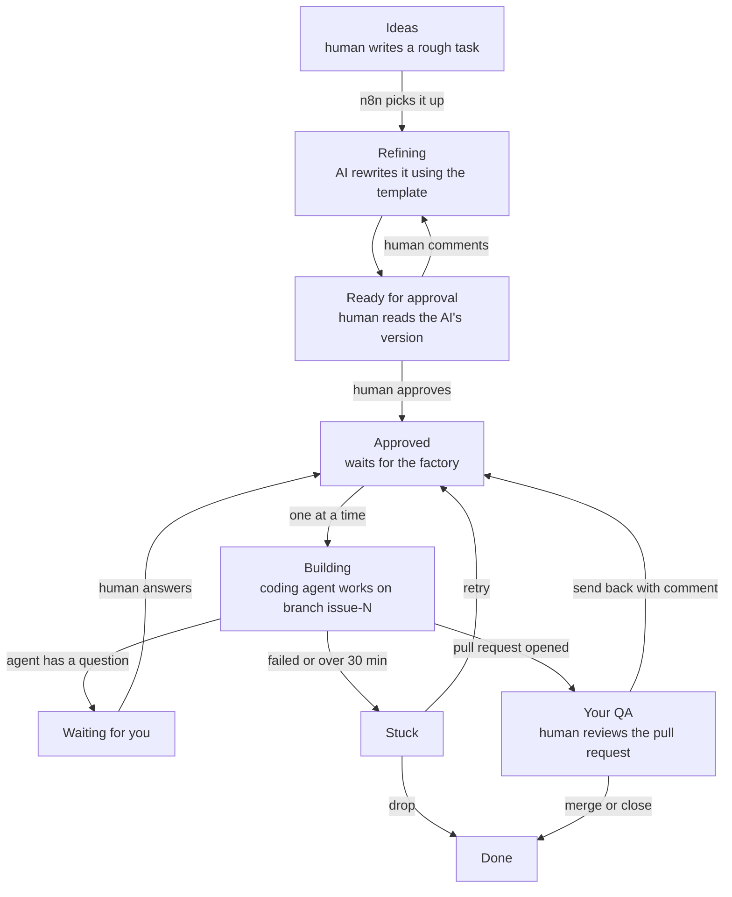

# Design

## State flow

Each task is a GitHub issue. Its label is its state.

## Who sets which label

| Label | Set by |
|---|---|
| Ideas | human |
| Refining | n8n |
| Ready for approval | n8n |
| Approved | **only the human** |
| Building | n8n |
| Waiting for you | n8n (Basic B) |
| Stuck | n8n (Basic B) |
| Your QA | n8n, when it sees the pull request |
| Done | n8n, when the pull request is merged or the issue is closed |

The AI advises, it never approves. There are two human gates:
before building (`Approved`) and before merging (QA).

## Permissions

The agent may:
- work in its own branch `issue-N`
- change files in the folder the task concerns
- write and run tests
- ask a question instead of guessing
- open a pull request

The agent may not:
- push or merge to `main` (protected by a branch ruleset)
- set labels, especially `Approved`
- build tasks that are not approved
- read or use the human's keys and tokens (enforced technically in Advanced, by running the agent in a container)

In Basic A and B the agent runs with the user's rights, so these rules are
instructions in the prompt, not technical limits.